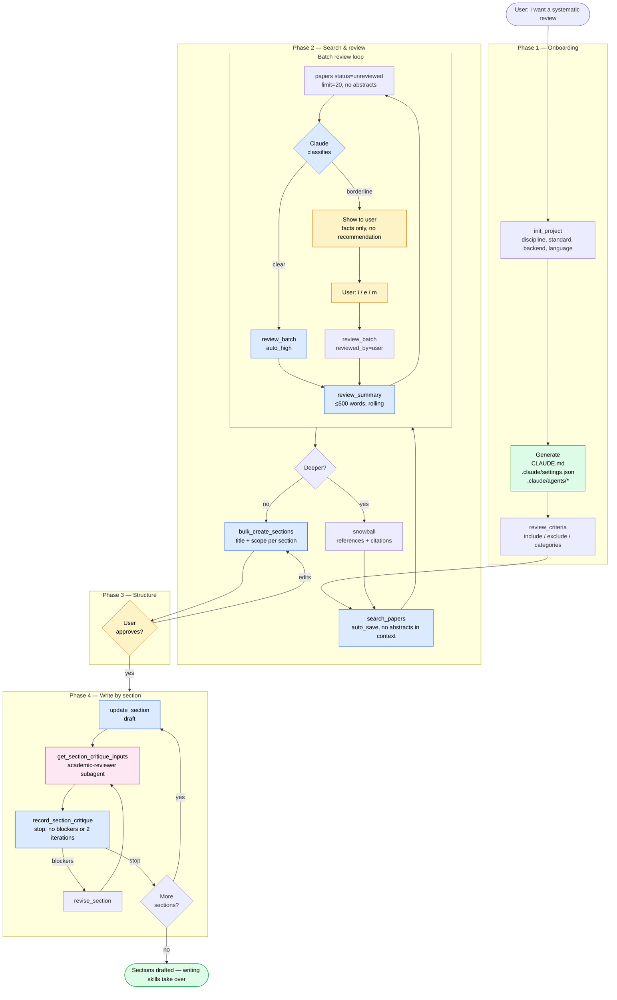

# snowcite

MCP server for systematic literature review. Search arXiv / Semantic Scholar / OpenAlex / Crossref / PubMed, snowball through citations, review papers through chat, keep a notes graph and cross-paper synthesis. Writing the document is left to the model and its skills — snowcite builds no PDF.

> No web UI, no browser, no second terminal. Claude reads abstracts in batches, pre-filters autonomously, surfaces borderline cases to you in chat.

## How it works



**Legend** — 🟨 user decisions, 🟦 automatic MCP calls, 🟪 subagents (fresh-context review), 🟩 outputs.

## Install

```bash
claude plugin marketplace add cop1cat/snowcite
claude plugin install snowcite@snowcite-plugins           # MCP server + review / synthesis / section skills
claude plugin install academic-writing@snowcite-plugins   # optional: Russian style, critic, GOST 7.32
```

Server only, without skills:

```bash
claude mcp add snowcite -- uvx snowcite
# optional keys for higher rate limits:
#   -e SNOWCITE_SEMANTIC_SCHOLAR_API_KEY=xxx -e SNOWCITE_OPENALEX_EMAIL=you@example.com
```

## First run

```
> I want a literature review on X for my bachelor thesis, in Russian, GOST 7.32
```

Claude calls `next_step()`, collects the project profile (language, discipline, standard,
optional author / institution / targets) and runs `init_project`, which scaffolds
`.snowcite/` in the current directory. From there `next_step()` drives the phases: criteria,
search, review, low-confidence confirmation, synthesis, then outline and drafting with
critique. Nothing but `.snowcite/` is written to your project.

## Projects live in directories

Like `.git`, a `.snowcite/` subdirectory marks a project. Work on multiple
reviews in parallel by `cd`-ing between them — no global state, no switching
commands. `git clone` moves a project to a new machine.

```
my-thesis/
├── .snowcite/
│   ├── papers.db         # project DB — metadata, papers, notes, sections, artifacts
│   └── cache/            # scratch space, always gitignored
└── ...                   # your own files; the document is built with your own toolchain
```

## Skills

| Plugin | Skills |
|---|---|
| `snowcite` | `workflow` (start here), `search`, `review`, `synthesis`, `sections` |
| `academic-writing` | `academic-writing-ru`, `academic-critic`, `gost-report`, agent `academic-reviewer` |

The server enforces the gates (summary before the next batch, notes for approved papers,
confirmed low-confidence calls); the skills carry the procedure.

## Docs

Full documentation: [cop1cat.github.io/snowcite](https://cop1cat.github.io/snowcite/). Coverage:

- Installation on macOS / Linux / Windows
- Workflow in depth (review loop, snowball, synthesis, section critique)
- Troubleshooting — safety refusals, source rate limits
- Artifacts — interviews, code and notes as sources

## Development

```bash
git clone https://github.com/cop1cat/snowcite.git
cd snowcite
uv sync --group dev
uv run pytest
uv run ruff check
uv run ruff format
claude plugin validate .   # marketplace + both plugins
```

CI runs ruff + pytest on every push and PR.

## What this isn't

- **Not a web UI.** Review happens in chat. Architectural choice, see `CLAUDE.md`.
- **Not a Zotero replacement.** We import BibTeX / RIS but don't integrate with Zotero's API.
- **Not a full-auto thesis generator.** Systematic review requires human judgment at
  criteria-setting, borderline papers, outline structure. snowcite automates the
  mechanical parts and keeps you in the loop for the rest.

## License

MIT — see `LICENSE`.
